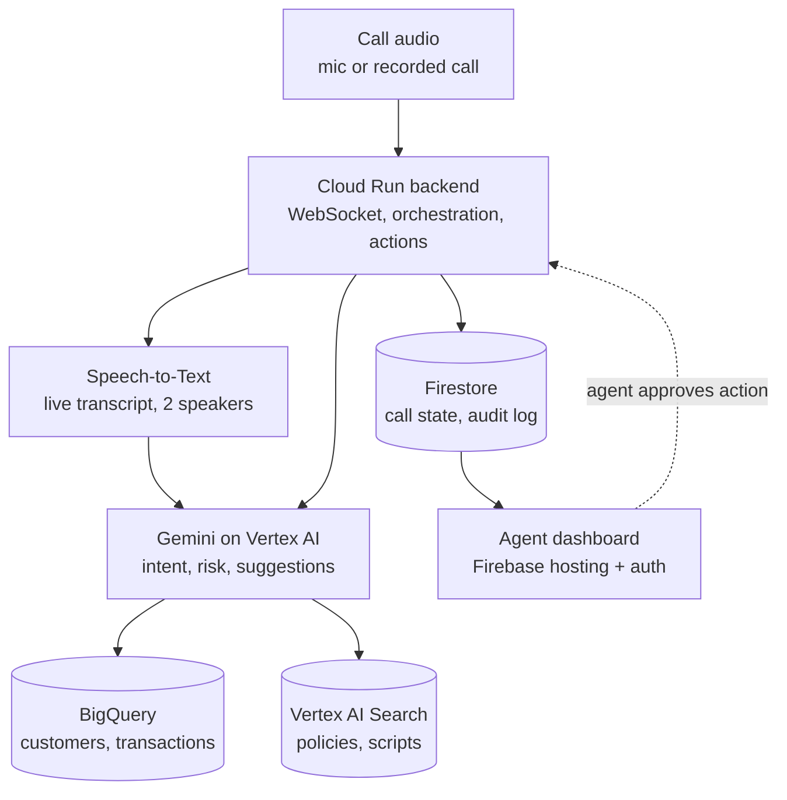
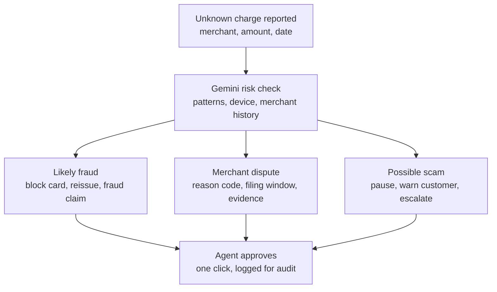

# Bank Agent Assist — brainstorm summary

> Context handoff for a new chat. This summarises a brainstorming session (12 Oct 2026) about a hackathon entry. Items marked **[doc]** come from the team's original pitch; items marked **[proposed]** were added during the review and aren't agreed yet.

## 1. The competition and the original idea

- **Event:** Google AI Builder Cup 2026, BFSI track: "Intelligent Risk, Fraud & Financial Experiences". Build an AI solution for banking, financial services or insurance: fraud and risk detection, process automation, customer interactions, or personalised financial experiences.
- **Pitch document:** "Bank Agent Assist — Google AI Builder Cup 2026" (9 Oct 2026, author @Arshi).
- **Team strength [doc]:** fintech experience building card products used by millions across 7 countries.

**Problem [doc].** Bank call-center agents handle disputes, fraud alerts, failed transactions and billing queries. Today they:
1. Switch between 4–6 legacy systems (CRM, billing, transaction DB, case management)
2. Piece the customer's history together by hand
3. Put the caller on hold repeatedly to research
4. Rely on memory for dispute procedures and compliance scripts
5. Retype customer details into forms (no pre-fill)
6. Read the next steps out from a script
7. Spend 5–10 minutes after each call updating systems and notes

The result is 6–10 minute calls, frustrated customers, burnt-out agents and high cost.

**Target user [doc].** The bank's support agent, not the end customer. The pitch calls this its point of difference from typical hackathon apps.

**Solution [doc].** An AI co-pilot for agents:
1. **Smart cardholder briefing:** profile, recent transactions and risk flags summarised when the call connects
2. **Live intent detection:** classifies the issue (dispute, fraud, limit request…) from the live conversation
3. **AI-suggested resolutions:** next steps, pre-filled forms, compliance-safe scripts
4. **One-click actions:** block card, start dispute, waive fee without switching systems

**Claimed impact [doc]:** handle time from 6–10 min to under 2 min; one view instead of 4–6 systems; onboarding from weeks to days; higher NPS; lower compliance risk.

## 2. Assessment

**Verdict:** worth pursuing, but it needs sharpening. The problem is real, the user is clear, it fits the category, it's demo-able, and Gemini is central to it. It won't win on novelty, though. It has to win on banking depth and execution.

**Main risks**
- **Google already sells "Agent Assist"** (part of Contact Center AI), which does live transcription, suggestions and summaries. NICE, Genesys, Salesforce and Cresta have similar products. Google judges may see this as their own product with a bank skin, and the name invites the comparison.
- **The pitch reads as a productivity tool**, while the category title stresses risk and fraud.
- **"Under 2 minutes" is unsupported.** It needs a timed demo, or should be called a target.
- **Legacy integration is the hard part in real life.** The demo will use mock data and should say so.
- **One-click actions on money** need visible human approval and an audit trail.

## 3. Sharpened direction [proposed]

Reposition from "agent productivity tool" to **a risk and fraud co-pilot for card operations**, built on banking depth that a general contact-center tool doesn't have:

- **Dispute and chargeback intelligence.** Map the customer's story to card-network reason codes (e.g. Visa 10.4, Mastercard 4837 for no cardholder authorisation). Check filing windows (60 days from the statement under Reg E and the Fair Credit Billing Act in the US; RBI rules for India). Pre-fill the dispute with evidence.
- **Fraud triage during the call.** Spot patterns: small test charges before a large one, a new device plus a new merchant category, unusual card-not-present spending. Recommend blocking the card versus disputing, and show the reasoning.
- **Scam-victim detection.** Flag when a caller may be coached by a fraudster (authorised push-payment scams, "bank official" pressure) and prompt the agent to pause and escalate.
- **Compliance that can be checked.** Track which required disclosures were read, with an audit log.

What the original doc already had as starting points: the dispute call example, "flagged risks" in the briefing, block-card and initiate-dispute actions, and compliance-safe scripts. It did **not** have reason codes, filing windows, AI pattern detection, scam detection or audit trails.

**Demo plan [proposed]**
1. Demo one flow really well: an unrecognised-charge call that ends as a dispute or a fraud block. Leave limit requests and billing out.
2. Lead with fraud and risk; present productivity as the bonus.
3. Human approval before every action, plus an audit log.
4. Synthetic cardholders and transactions in BigQuery, with fraud patterns planted on purpose.
5. A timed side-by-side (old way vs. assisted) instead of a bare "under 2 min" claim.
6. Consider renaming (e.g. "DisputeIQ", "Card Ops Co-pilot") to avoid echoing Google's Agent Assist.

## 4. Tech stack

The original stack had **no way to hear the call**, even though live listening is central to the pitch.

| Need | Tool | Role | Status |
|---|---|---|---|
| Reasoning and summaries | Gemini on Vertex AI | Briefing, intent, risk reasoning, suggestions, wrap-up | [doc] |
| Hearing the call | Speech-to-Text (Chirp, streaming) | Live transcript, agent and customer kept apart (two audio channels beats automatic speaker detection) | [proposed] |
| Intent detection | Dialogflow CX | **Dropped.** It's built for bot-led conversations; here two humans talk and the AI only listens, so Gemini classifies intent from the transcript | [doc] → dropped |
| Customer and transaction data | BigQuery | Mock data for the demo | [doc] |
| Policies and scripts | Vertex AI Search | Grounds suggestions in dispute and fraud procedures, which reduces made-up answers | [proposed] |
| Live call state and audit log | Firestore | Pushes live updates to the dashboard and records every action | [proposed] |
| Backend | Cloud Run | WebSocket server, orchestration, action endpoints | [doc] |
| Frontend and sign-in | Firebase | Agent dashboard hosting and login | [doc] |

**Simpler alternative:** the Gemini Live API takes streaming audio directly, handling transcription and understanding on one connection. That means fewer parts, but less control over the transcript and speaker labels.

**Call audio for the demo:** browser microphone or a pre-recorded call played back live. Real banks would route audio from telephony platforms (Genesys, Google's contact-center platform).

## 5. Architecture

Cloud Run is the hub. Gemini reaches BigQuery and Vertex AI Search through tool calls. Everything the agent sees goes through Firestore, so the dashboard updates live. When the agent approves an action, it goes back through Cloud Run and is written to the audit log.

## 6. Flows

**Live call (agent's view)**
1. Call connects → AI cardholder briefing
2. Customer explains the issue → live transcript streams in
3. Gemini detects intent (dispute / fraud / scam)
4. Suggested resolution card: steps, script, pre-filled form
5. **Agent approves** an action (block card, file dispute). The AI never skips this step.
6. Automatic wrap-up: notes, case update, audit log

Steps 2–4 repeat and refine as the conversation goes on.

**Unrecognised charge: decision paths [proposed]**

| Path | Signals | Suggested action |
|---|---|---|
| Likely fraud | Test charges before a large one; new device plus new merchant category; card-not-present spending far from usual | Block and reissue, open fraud claim, read fraud disclosure |
| Merchant dispute | Customer recognises the merchant but not the amount; cancelled subscription still billing | Map to reason code, check filing window, pre-fill dispute with evidence |
| Possible scam | Customer authorised the payment under pressure; "bank official" or urgent transfer; coached-sounding replies | Pause the transaction, warn the customer, hand off to the fraud team |

## 7. For a real deployment (pitch talking points)

- Recording and analysing calls needs the customer's consent.
- Card numbers in transcripts must be masked before reaching the model or the logs.
- Legacy bank system integration is the hardest part; the demo doesn't attempt it.

## 8. Open questions / next steps

- Final product name.
- Speech-to-Text plus Gemini, or the Gemini Live API?
- Which region's rules to show (US Reg E/FCBA vs. India RBI)? Pick one for the demo.
- Mock dataset design: cardholders, transactions, planted fraud patterns.
- Demo script: the sample customer call(s) and the timed before/after comparison.
- Dashboard layout: briefing panel, live transcript, suggestion card, action bar, audit log.

**Visual version:** an interactive page with these diagrams was published as a private artifact (https://claude.ai/artifact/XwVCJRVXWEK5yjh3unhy5W). It opens only for the owner or people it's been shared with.
