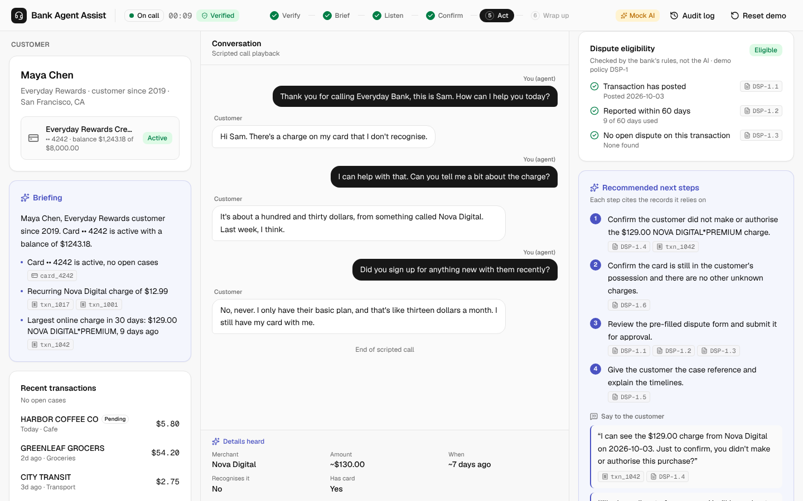

# Bank Agent Assist

An AI co-pilot for bank card-servicing agents. Entry for the **Google AI Builder Cup 2026**, BFSI track (Intelligent Risk, Fraud & Financial Experiences).

**AI recommends. Agents decide. Banking systems execute.**

When a customer calls, the assistant verifies the caller, briefs the agent, follows the conversation, matches the issue to the right transaction, and recommends a policy-backed resolution with evidence. The agent approves every action, and each one is logged for audit.



## Status: M0 prototype

Scenario A runs end to end: a customer calls about a $129 charge she doesn't recognise, and the call ends in a dispute case. See [docs/M0.md](docs/M0.md).

## Run it

Requires Node 20+.

```bash
npm install
npm run dev          # http://localhost:3000
```

With no configuration the app uses **Mock AI** (simple offline rules, labelled in the header) so the flow always works. To use Gemini, create `apps/web/.env.local` from [`apps/web/.env.example`](apps/web/.env.example):

```bash
GEMINI_API_KEY=...                # from Google AI Studio
# or Vertex AI:
# GOOGLE_GENAI_USE_VERTEXAI=true
# GOOGLE_CLOUD_PROJECT=your-project
# GOOGLE_CLOUD_LOCATION=global
```

**Demo:** Start call → verify with `1990-04-14` and `4242` → Play call → Customer confirmed this charge → Review and approve → Wrap up call. Run it again without resetting to see the "case already open" path. **Reset demo** clears all cases.

## Repo layout

```
apps/web/          Next.js app: agent workspace UI (shadcn/ui) + API route handlers
packages/core/     Call flow, rules (eligibility, matching, evidence), Gemini + mock AI, data store, tests
data/              Fictional seed data, demo dispute policy, scripted calls
docs/              Scope, M0 flow, brainstorm, references, screenshots
```

| Command | What it does |
|---|---|
| `npm run dev` | Start the app in development mode |
| `npm test` | Unit tests for `packages/core` |
| `npm run typecheck` | TypeScript across all workspaces |
| `npm run build` | Production build (what CI runs) |

## Contributing

Work on a branch and open a pull request to `main`. CI (typecheck, tests, build) must pass and one approval is needed. See [.github/rulesets](.github/rulesets/README.md) for the branch protection setup.

## Docs

- [docs/SCOPE.md](docs/SCOPE.md): domain, problem statement, proposal and boundaries; Must / Should / Could buckets, milestones, Google services by feature
- [docs/M0.md](docs/M0.md): the M0 flow, step by step, and the code map
- [docs/BRAINSTORM.md](docs/BRAINSTORM.md): the original idea, assessment and architecture options
- [docs/reference/](docs/reference/): original pitch PDF and the ChatGPT session export

All customers, transactions and policies in this repo are fictional.
