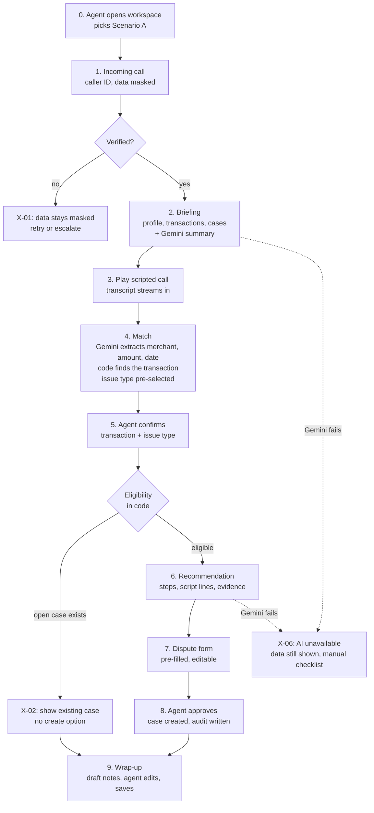

# M0: starter prototype flow

> Status: **draft for team review**. M0 is the first working slice of [SCOPE.md](SCOPE.md). It runs on a laptop, uses real Gemini calls, and covers one scenario end to end.

**M0 proves one thing:** an unstructured customer conversation becomes a verified, policy-checked, agent-approved banking action, with evidence and an audit trail.

---

## 1. What's in M0

| In | Out (later milestones) |
|---|---|
| One scenario: **A, unrecognised charge → dispute** | Scenarios B, C; failed-transaction and fee playbooks |
| One fictional customer, one card, ~15 transactions | More customers |
| Scripted call playback | Microphone / Speech-to-Text |
| Caller verification (form) | Real agent sign-in: M0 uses a fixed `demo-agent` |
| Briefing with Gemini summary + evidence | Risk flags |
| Transaction matching from the transcript | Ambiguous-match UI (X-03) |
| Eligibility in code, recommendation with evidence | Policy excerpts inline |
| Dispute form → approval → case created → audit | Card block, fee waiver, reversal |
| Wrap-up notes | Disposition codes |
| Exceptions: **X-01** unverified, **X-02** dispute already exists, **X-06** Gemini fails | X-03, X-04, X-05, X-07 |
| In-memory data loaded from JSON, behind a repository interface | Firestore (M1) |
| Runs locally | Cloud Run + Firebase deployment (M1) |

**Why in-memory data for M0:** no emulator or cloud project is needed to start, so anyone can run it in minutes. The data layer is an interface, so Firestore drops in at M1 without touching routes or UI.

---

## 2. The demo scenario (A)

| | |
|---|---|
| Customer | **Maya Chen** (fictional), credit card ending **4242**, customer since 2019 |
| Verification | Date of birth + last 4 digits of the card |
| Disputed charge | **$129.00, NOVA DIGITAL\*PREMIUM**, posted 9 days ago |
| Why it's interesting | Maya has an older $12.99 NOVA DIGITAL charge she *does* recognise, so Gemini must pick the right one by amount and date |
| Fictional policy | Dispute allowed if the transaction is **posted**, **within 60 days**, and has **no open case** |
| Expected outcome | Eligible → dispute case created → notes saved |
| Second run | The case now exists → **X-02**: existing case shown, no create button |

**Scripted call (6 turns)**

| # | Speaker | Line |
|---|---|---|
| 1 | Agent | Thank you for calling, this is Sam. How can I help? |
| 2 | Customer | Hi, there's a charge on my card I don't recognise. |
| 3 | Agent | I can help with that. Can you tell me about the charge? |
| 4 | Customer | It's about a hundred and thirty dollars, from something called Nova Digital, last week I think. |
| 5 | Agent | Did you sign up for anything with them recently? |
| 6 | Customer | No, never. I've only got their basic plan, and that's like thirteen dollars. |

---

## 3. The flow, step by step



| Step | Agent does | Screen shows | API call | Gemini? |
|---|---|---|---|---|
| 0 | Opens the app, picks "Scenario A", clicks **Start call** | Empty workspace, "Incoming call" | `POST /api/calls` `{scenarioId}` → `callId`, caller ID | – |
| 1 | Asks verification questions, enters DOB + last 4 | Caller ID, masked name and card | `POST /api/calls/:id/verify` | – |
| 2 | Reads the briefing | Profile, card, last 15 transactions, open cases, 3–4 line summary with evidence chips | `GET /api/calls/:id/briefing` | **Summary** |
| 3 | Clicks **Play** (or steps turn by turn) | Transcript appears turn by turn | `POST /api/calls/:id/turns` after each customer turn | **Extract facts** |
| 4 | Watches the match appear | Highlighted transaction ($129 NOVA DIGITAL), extracted facts, issue type "Unrecognised charge" pre-selected | (response from step 3) | – |
| 5 | Clicks **Confirm** on the transaction and issue type | Eligibility result: ✓ posted, ✓ 9 of 60 days, ✓ no open case | `POST /api/calls/:id/recommendation` | **Recommendation** |
| 6 | Reads the steps and script lines to the customer | Recommendation card: steps, script lines, each with evidence chips (`txn_…`, `policy:DSP-1`) | (response from step 5) | – |
| 7 | Reviews and edits the dispute form | Form pre-filled: customer, card, transaction, amount, reason, customer statement | `POST /api/disputes/preview` | – |
| 8 | Clicks **Submit dispute**, then **Confirm** in the dialog | Case reference `DSP-2026-0001`, status Open | `POST /api/disputes` with idempotency key | – |
| 9 | Reviews draft notes, edits, clicks **Save & end call** | Draft notes; audit drawer lists every event | `GET` / `POST /api/calls/:id/wrap-up`, `GET /api/calls/:id/audit` | **Wrap-up notes** |

---

## 4. Workspace layout

One screen. Panels light up as the call moves through its stages.

```
┌───────────────────────────────────────────────────────────────────────────────┐
│ Bank Agent Assist   ● Call active 01:42   Maya Chen ✓ verified   [Audit log]  │
├────────────────────────┬───────────────────────────┬──────────────────────────┤
│ CUSTOMER               │ CONVERSATION              │ CO-PILOT                 │
│                        │                           │                          │
│ Verify ▸ DOB, last 4   │ Agent: Thank you for...   │ Issue: [Unrecognised ▾]  │
│                        │ Cust:  There's a charge...│                          │
│ Briefing summary       │ Cust:  ~$130, Nova...     │ Matched transaction      │
│  "Customer since 2019, │                           │  $129.00 NOVA DIGITAL    │
│   no open cases..."    │ [▶ Play] [⏭ Step]         │  9 days ago  [Confirm]   │
│   [txn_1042][card_01]  │                           │                          │
│                        │ Extracted                 │ Eligibility              │
│ Card •• 4242  Active   │  merchant: Nova Digital   │  ✓ posted ✓ 9/60 days    │
│                        │  amount:   ~$130          │  ✓ no open case          │
│ Recent transactions    │  date:     last week      │                          │
│  ▸ $129.00 NOVA DIG ◀  │                           │ Recommended steps        │
│    $12.99 NOVA DIG     │                           │  1. ... [policy:DSP-1]   │
│    $54.20 GROCER       │                           │ Say to customer          │
│    ...                 │                           │  "..."                   │
│ Open cases: none       │                           │ [Review dispute form]    │
├────────────────────────┴───────────────────────────┴──────────────────────────┤
│ WRAP-UP  Draft notes (editable) ...                     [Save & end call]     │
└───────────────────────────────────────────────────────────────────────────────┘
```

---

## 5. The four Gemini calls

All four return JSON checked against shared schemas in `packages/shared`. If a call fails or returns invalid JSON, the UI shows the X-06 state and the agent carries on manually.

| Call | Input | Output (fields) | Backend check after |
|---|---|---|---|
| **Briefing summary** | Customer, card, transactions, open cases | `summary`, `highlights[] {text, evidenceIds[]}` | Every evidence ID must exist for this customer |
| **Extract facts** (per customer turn) | Transcript so far | `merchant?`, `amount?`, `dateHint?`, `customerRecognises?`, `suggestedIssueType` | Code (not Gemini) finds transactions matching merchant ± amount ± date window |
| **Recommendation** | Confirmed transaction, eligibility result (from code), policy text | `steps[] {text, evidenceIds[]}`, `scriptLines[]`, `formPrefill {reason, customerStatement}` | Evidence IDs verified; prefill re-validated against the form schema |
| **Wrap-up notes** | Transcript, actions taken, case reference | `notes`, `followUps[]` | Must mention the real case reference; agent edits before saving |

**Gemini never:** decides eligibility, chooses an action, or calls an action endpoint.

---

## 6. Data for M0

```
data/
  seed/
    customers.json       1 customer (Maya Chen) + DOB for verification
    cards.json           1 card •• 4242
    transactions.json    ~15 transactions over 60 days, incl. $129 and $12.99 NOVA DIGITAL
    cases.json           empty at start
  policies/
    disputes.json        DSP-1: posted, ≤ 60 days, no open case (+ plain-text version for Gemini)
  calls/
    scenario-a.json      6 turns from section 2
```

Runtime state (call sessions, created cases, audit events) is kept in memory. A **Reset demo** button clears it.

---

## 7. Code to write for M0

| Area | Files | Notes |
|---|---|---|
| Shared | `packages/shared/src/schemas.ts` | Zod schemas for the 4 Gemini outputs + API requests |
| API | `apps/api/src/routes/{calls,disputes}.ts` | The 8 endpoints in step table |
| | `apps/api/src/ai/{client,prompts,briefing,extract,recommend,wrapup}.ts` | `@google/genai`; works with a Gemini API key (AI Studio) or Vertex AI via env |
| | `apps/api/src/domain/{eligibility,matching,evidence,actions}.ts` | All deterministic, unit-tested |
| | `apps/api/src/data/{repository,memory}.ts` | Interface + in-memory implementation |
| | `apps/api/src/audit/log.ts` | Append-only events |
| Web | `apps/web/src/workspace/*` | 3 columns + wrap-up bar + audit drawer |
| | `apps/web/src/simulator/player.ts` | Plays `scenario-a.json` with a delay per turn |
| Tests | `apps/api/test/*` | Eligibility, matching, evidence check, duplicate dispute, unverified access, AI fallback |

**Config (`.env.example`):** `GEMINI_API_KEY` *or* `GOOGLE_GENAI_USE_VERTEXAI=true` + `GOOGLE_CLOUD_PROJECT` + `GOOGLE_CLOUD_LOCATION`; `GEMINI_MODEL`.

---

## 8. Done when

1. `npm install && npm run dev` starts the API and the workspace.
2. A teammate completes scenario A, from Start call to Save & end call, in under 3 minutes.
3. The $129 transaction is matched (not the $12.99 one) from the transcript.
4. Every evidence chip on screen points to a real record.
5. A wrong DOB keeps customer data masked (X-01).
6. Starting the scenario again without reset shows the existing case and no create option (X-02).
7. With Gemini disabled (bad key), the call still completes manually (X-06).
8. The audit log shows: call started, verified, transaction confirmed, dispute created, notes saved; each with actor, time and evidence IDs.
9. Unit tests pass.
